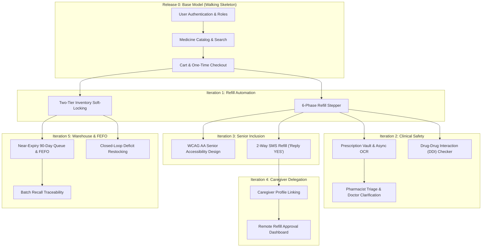

# 🗺️ Product Roadmap: Auto-Meds

> **Document Type:** Agile Iterative Product Roadmap & Release Plan  
> **Target Audience:** Engineering Leads, Product Managers, TPM Interviewers, Agile Coaches  
> **Methodology:** Incremental Agile Delivery (Base MVP Model ➔ Iterative Feature Slices)  
> **Timeline / Perspective:** Pre-Development Phased Release Strategy  
> **Author:** Aaditya Aanand  

---

## 1. Agile Roadmap Philosophy: Walking Skeleton to Mature Platform

Rather than attempting a big-bang healthcare release, Auto-Meds follows an **iterative Agile delivery model**. 

We start with a **Base Model (Walking Skeleton)** that proves the fundamental e-pharmacy transactional loop. Subsequent iterations layer on 2 to 3 targeted capabilities per release slice, directly expanding patient safety, automation, and clinical compliance.

```
┌────────────────────────────────────────────────────────────────────────────────────────┐
│                               AGILE RELEASE PROGRESSION                                │
├────────────────────────────────────────────────────────────────────────────────────────┤
│  Sprint 01-02: Base Model (The Walking Skeleton)                                       │
│                • Core Catalog, Cart, User Auth, Basic Order Checkout                   │
│                                           ▼                                            │
│  Iteration 01: Core Refill Automation & Stock Protection                              │
│                • 6-Phase Scheduled Refill Engine                                       │
│                • Two-Tier Inventory Soft-Locking (5-day reservation)                   │
│                                           ▼                                            │
│  Iteration 02: Clinical Safety & Prescription Intelligence                             │
│                • Prescription Upload & Background OCR Scanning                         │
│                • Pharmacist Triaging Console & Doctor Clarification                    │
│                • Drug-Drug Interaction (DDI) Safety Alerts                             │
│                                           ▼                                            │
│  Iteration 03: Senior Ergonomics & Multi-Channel Inclusion                             │
│                • Universal Senior Accessibility (WCAG 2.1 AA targets)                  │
│                • Interactive 2-Way SMS Refills ("Reply YES" via Twilio)                │
│                                           ▼                                            │
│  Iteration 04: Caregiver Delegation & Family Oversight                                 │
│                • Authorized Caregiver Profile Linking                                  │
│                • Remote Dependent Refill Approval & Order Tracking                     │
│                                           ▼                                            │
│  Iteration 05: Closed-Loop Warehouse Operations & Traceability                         │
│                • Near-Expiry Surveillance (90-day alert desk) & FEFO Dispensing         │
│                • Manufacturer Batch Recall Tracking                                    │
│                • Closed-Loop Deficit Restocking Queue                                  │
│                                           ▼                                            │
│  Future Horizons (Post-MVP Epics):                                                     │
│                • One-Touch "Simple Mode" UI • Cloud S3 Object Storage • Daily DoseLog   │
└────────────────────────────────────────────────────────────────────────────────────────┘
```

---

## 2. Iteration Breakdown & User Stories

### 🧱 Release 0: The Base Model (Walking Skeleton)
* **Goal:** Prove basic transactional viability before introducing scheduled complexity.
* **Scope / Deliverables:**
  1. **User Authentication & Role-Based Access Control:** Secure registration, login, and session tokens for `PATIENT` and `ADMIN` personas.
  2. **Medicine Catalog & Search:** Simple database-backed search across trade names, strength, and categories.
  3. **Cart & Standard Checkout:** Add to cart, view total price, and submit order for immediate home delivery.
* **Exit Criteria:** A patient can register, search for a medicine, place a one-time order, and view order confirmation.

---

### 📦 Iteration 1: Core Refill Automation & Stock Protection
* **Goal:** Eliminate manual reorder fatigue and protect chronic stock from sudden depletion.
* **Increment (2 Core Features):**
  1. **6-Phase Scheduled Refill Engine:** Allows patients to configure recurring maintenance schedules (e.g., 30-day supplies) that automatically trigger an evaluation 5 days before medication exhaustion.
  2. **Two-Tier Inventory Soft-Locking:** Ring-fences required units 5 days ahead of dispatch (`reserved_quantity`), ensuring walk-in buyers cannot buy out stock promised to chronic patients.
* **User Value Delivered:** Rajesh (Busy Chronic Patient) sets his dosage schedule once and never has to manually re-order his daily maintenance tablets each month.

---

### 🩺 Iteration 2: Clinical Safety & Prescription Intelligence
* **Goal:** Transform consumer e-commerce into a legally compliant, clinically safe medical platform.
* **Increment (3 Core Features):**
  1. **Digital Prescription Intake & OCR:** Secure prescription image upload with automated background text scanning to assist pharmacist review without blocking request threads.
  2. **Pharmacist Triage Console & Doctor Clarification:** Split-screen verification desk allowing pharmacists to approve, reject with clinical notes, or put orders on hold to consult prescribing doctors.
  3. **Drug-Drug Interaction (DDI) Safety Alerts:** Real-time cross-referencing of active patient medications to prevent adverse pharmacological clashes.
* **User Value Delivered:** Dr. Meera (Pharmacist) verifies prescriptions 3× faster and catches harmful drug combinations before dispensing.

---

### 👵 Iteration 3: Senior Ergonomics & Multi-Channel Inclusion
* **Goal:** Bridge the digital divide for elderly and low-tech cohorts.
* **Increment (2 Core Features):**
  1. **Universal Senior Accessibility (WCAG 2.1 AA):** High-contrast color ratios, dynamic font scaling, and minimum $44 \times 44\text{px}$ touch targets to accommodate tremors and low vision.
  2. **Interactive 2-Way SMS Refills ("Reply YES"):** Zero-app confirmation channel allowing patients without smartphones or computer literacy to confirm monthly deliveries via a simple text message.
* **User Value Delivered:** Shanti Devi (Elderly Patient) confirms her scheduled delivery by simply texting "YES" without struggling with passwords or small screen buttons.

---

### 🤝 Iteration 4: Caregiver Delegation & Family Oversight
* **Goal:** Give remote adult children authorized oversight of their elderly parents' care.
* **Increment (2 Core Features):**
  1. **Authorized Caregiver Profile Linking:** Secure, two-way consent mechanism connecting a caregiver account to dependent patient profiles.
  2. **Remote Refill Approval & Delivery Tracking:** Caregiver dashboard displaying parents' upcoming refills, allowing remote family members to approve orders and track doorstep fulfillment.
* **User Value Delivered:** Vikram (Long-Distance Caregiver) can supervise and approve his parents' refills from another city with complete peace of mind.

---

### 🛡️ Iteration 5: Closed-Loop Warehouse Operations & Traceability
* **Goal:** Optimize pharmacy inventory, prevent expired medicine dispensing, and automate stockout recovery.
* **Increment (3 Core Features):**
  1. **Near-Expiry Surveillance & FEFO Dispensing:** 90-day expiry triage desk enforcing a First-Expired, First-Out rule to eliminate medicine waste.
  2. **Manufacturer Batch Recall Tracking:** Tracking specific lot numbers and expiration dates per stock unit for regulatory compliance and targeted recalls.
  3. **Closed-Loop Deficit Restocking:** Automated waiting queue that immediately routes fresh incoming inventory to backlogged chronic subscriptions before opening stock to general sale.
* **User Value Delivered:** Pharmacy operations eliminate expired inventory write-offs, and patients stalled by temporary stockouts are fulfilled automatically upon restock.

---

## 3. Agile Dependency Graph



---

## 4. Post-MVP Future Horizons (Later Backlog)

Future iterations scheduled after MVP stabilization:

| Future Epic | Target Horizon | Planned Scope |
| :--- | :--- | :--- |
| **One-Touch "Simple Mode" UI** | Post-MVP Iteration 6 | Dedicated ultra-high contrast senior layout with massive $\ge 56\text{px}$ targets and 3-button navigation (`My Meds`, `Order Status`, `Help`). |
| **Cloud Object Storage Migration** | Post-MVP Iteration 7 | Move prescription uploads to AWS S3 / MinIO object storage with encrypted pre-signed view URLs. |
| **Daily DoseLog Adherence Tracking** | Post-MVP Iteration 8 | Daily medication logging (`Taken` / `Missed`) with calculated Proportion of Days Covered (PDC) scores. |
| **Direct EHR / FHIR Interoperability** | Enterprise Scale | Direct digital prescription ingestion from hospital systems using HL7 FHIR standards. |
