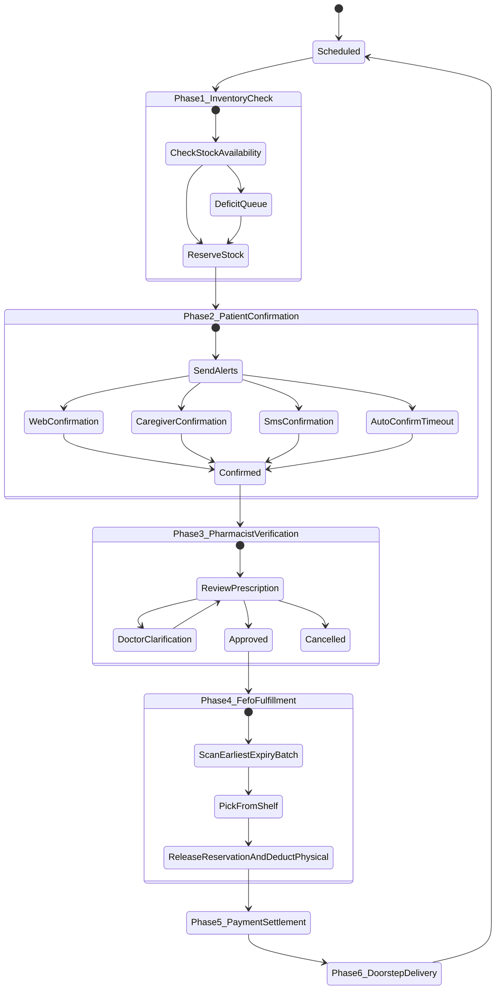
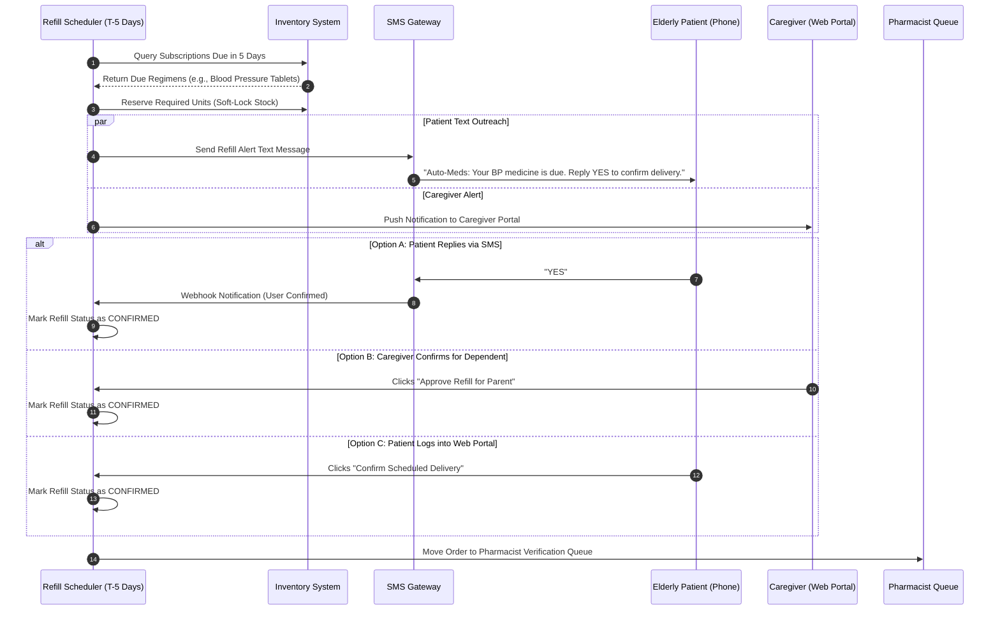
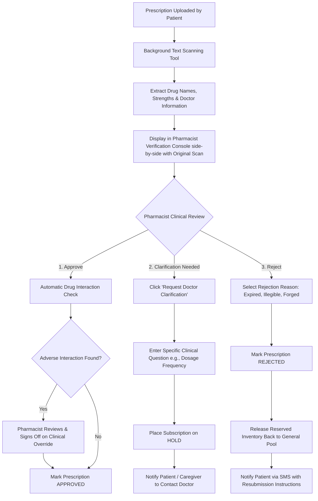
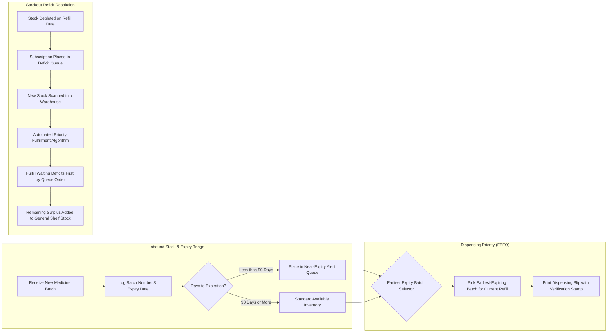

# 🔄 User Flows & Interaction Workflows: Auto-Meds

> **Document Type:** Interaction Design & System Workflows Specification  
> **Target Audience:** Engineering Leads, Product Designers, Technical Program Managers (TPMs)  
> **Timeline / Perspective:** Pre-Development Workflow Design & Architecture  
> **Notation:** Mermaid.js diagrams (rendering natively on GitHub)  
> **Author:** Aaditya Aanand  

---

## 1. Planned End-to-End Refill Lifecycle (6-Phase Stepper)

Rather than treating prescription refills as a single instantaneous checkout button, the platform is designed around a **predictive 6-phase state machine** that initiates 5 days before a patient exhausts their medication:

---

## 2. Multi-Channel Patient & Caregiver Confirmation Workflow

This interaction flow specifies how low-tech elderly patients and remote family caregivers can approve scheduled deliveries with zero friction.

---

## 3. Pharmacist Prescription Verification & Doctor Clarification Flow

This workflow defines the clinical checks required before any medication can be physically packed and dispensed.

---

## 4. FEFO Inventory Control & Stockout Deficit Recovery

This workflow designs how warehouse inventory is protected against expiration and how temporary stockouts recover automatically.

---

## 5. Planned Failure & Exception Scenarios

To ensure safety and predictable behavior, the following edge cases were defined prior to implementation:

| Failure / Edge Case | Detection Mechanism | Planned System Response |
| :--- | :--- | :--- |
| **Insufficient Stock at T-5 Days** | Available stock check returns less than required dosage. | Move order to `DEFICIT_BACKLOG`; alert procurement team; notify patient that their refill is queued with priority fulfillment upon shipment arrival. |
| **Prescription Expired Prior to Refill** | Doctor prescription validity date passes before next refill date. | Halt automated dispatch; alert patient and caregiver 14 days in advance to upload an updated prescription from their physician. |
| **Patient Unresponsive Across All Channels (48 hrs)** | Confirmation timer expires with no SMS reply or portal click. | If tagged as an essential chronic maintenance drug, automatically advance to pharmacist review so therapy is not dropped; otherwise hold dispatch to prevent pill stockpiling. |
| **Dangerous Drug-Drug Interaction Detected** | Clinical interaction engine flags conflicting drugs in patient's active list. | Block one-click approval; require pharmacist to review interaction warning and enter clinical notes before releasing. |
| **Image Scanning Fails (Blurry / Dark Photo)** | Scanned text confidence is too low or image is unreadable. | Automatically tag as `MANUAL_REVIEW_REQUIRED`; preserve original image for pharmacist visual inspection. |
