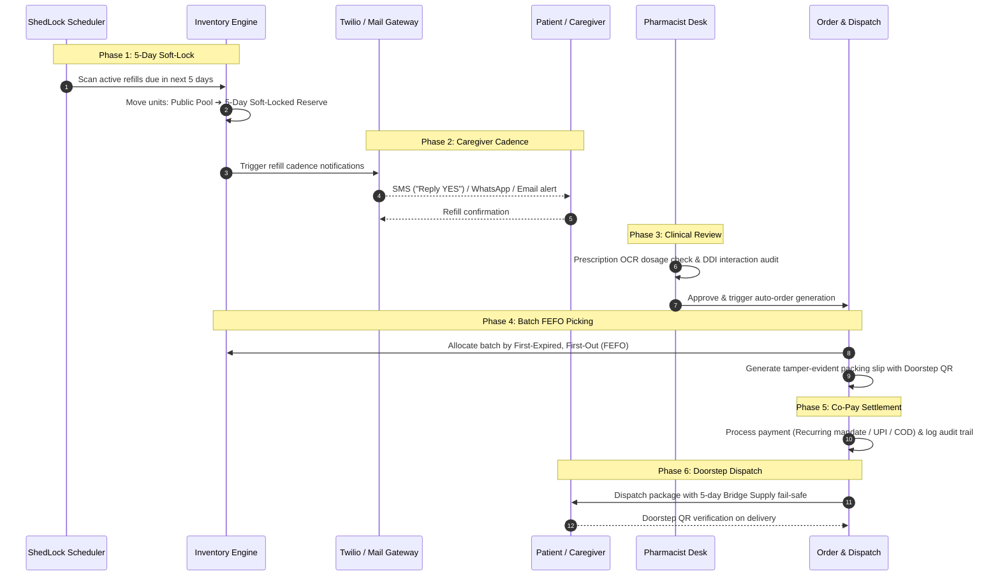

# 🏥 Auto-Meds: Smart E-Pharma & Automated Refill Subscription Platform

<div align="center">

  [](https://spring.io/projects/spring-boot)
  [](https://angular.io/)
  [](https://www.postgresql.org/)
  [](https://www.oracle.com/java/)
  [](https://docs.docker.com/compose/)
  [-FF9900.svg?logo=amazon-aws&logoColor=white)](AWS_DEPLOYMENT_GUIDE.md)
  [](#-interactive-codebase-knowledge-graph)
  [](https://jwt.io/)
  [](https://www.w3.org/WAI/standards-guidelines/wcag/)
  [](LICENSE)

  <p align="center">
    <strong>An enterprise-grade, compliance-driven E-Pharmacy platform automating maintenance medication cycles, clinical prescription verification, real-time inventory soft-locking, and caregiver delegation — with built-in WCAG AA accessibility for elderly patients.</strong>
  </p>

  [Features](#-key-features) •
  [Architecture](#-system-architecture) •
  [Knowledge Graph](#-interactive-codebase-knowledge-graph) •
  [Refill Lifecycle](#-autonomous-chronic-refill-lifecycle-6-phase-coordinated-engine) •
  [Getting Started](#-getting-started) •
  [Docker](#-docker-deployment) •
  [AWS Cloud ($0/mo)](#️-aws-free-tier-cloud-deployment-000mo) •
  [API Reference](#-api-endpoints) •
  [Accessibility](#-accessibility-wcag-aa) •
  [Demo Credentials](#-demo-credentials)

</div>

---

## 📌 Problem Statement & Solution

Millions of patients suffering from chronic conditions (hypertension, diabetes, cardiac care) face critical gaps in their medication cycles:
1. **Forgetfulness & Friction** — Missing monthly reorders leads to therapy discontinuation.
2. **Local Pharmacy Stockouts** — Absence of immediate, clinically-safe generic alternative suggestions.
3. **Friction for Elderly & Low-Tech Users** — Inaccessible UI layouts and lack of automated SMS alternatives.
4. **Caregiver Blindspots** — Family members cannot remotely manage prescriptions and deliveries for dependent parents.

**Auto-Meds** bridges the gap between commercial e-commerce convenience and medical compliance:
- **Set-and-Forget Auto-Refills** with distributed ShedLock scheduling and 5-day predictive dispatch cycles.
- **SMS Refill Confirmation** — Interactive refill confirmation via Twilio SMS ("Reply YES") with zero app requirement.
- **Async OCR Engine** — Dedicated thread-pool prescription analysis extracting medicines without blocking HTTP threads.
- **Caffeine In-Memory Caching** — High-throughput catalog queries with automatic cache eviction on inventory updates.
- **Generic Alternative Engine** — Automatic Bio-equivalent drug substitution matching identical chemical composition and dosage strength.
- **Near-Expiry & Batch Traceability** — Proactive 90-day expiry triage and manufacturer batch tracking for recall compliance.
- **Full Caregiver Delegation** — Family members can link patient profiles to supervise prescriptions and orders.
- **Real-Time SSE Feeds** — Live server-sent events for instant order status progression and stock alerts.
- **WCAG AA Accessibility** — 44px minimum touch targets, high-contrast focus rings, font scaling, and reduced-motion support.

---

## 🚀 Key Features

### 👨‍⚕️ Patient & Caregiver Experience
- **Dynamic Catalog & Smart Search**: Real-time multi-attribute search across trade names, composition, manufacturer, and ailments.
- **Zero Stock Count Leaks & Anti-Panic UX**: Commercial stock units are concealed from patients to prevent hoarding; out-of-stock items automatically disable Add to Cart and present instant generic alternatives.
- **Composition-Based Alternative Resolution**: If an item is out of stock or high-cost, suggests bio-equivalent generic alternatives matching identical active salts and strength.
- **Digital Prescription Vault**: Secure upload with OCR processing, physician tracking, and expiration validation.
- **Recurring Medication Subscriptions**: Configurable dosage schedules (e.g., 2 tablets/day for 30 days) with automated refill pipelines.
- **Interactive SMS Refill Alerts**: Patients can confirm auto-refills straight from standard SMS ("Reply YES") or WhatsApp without opening a browser.
- **Full Caregiver Delegation**: Family members can link patient profiles to supervise prescriptions, review interactions, and track deliveries.
- **Clinical Drug-Drug Interaction (DDI) Checker**: Real-time safety validation across active medication regimens to prevent adverse pharmacological events.

### 🛡️ Admin & Pharmacist Control Center
- **Prescription Triaging & Async OCR**: Automated text extraction with pharmacist approval/rejection workflows, dosage validation, and doctor clarification requests.
- **Autonomous 6-Phase Refill Stepper**: Live visual lifecycle tracker orchestrating 5-day soft-lock, caregiver alerts, clinical review, FEFO picking, payment settlement, and delivery dispatch.
- **1-Click Generic Medicine Builder**: Rapid cloning tool allowing pharmacists to spawn bio-equivalent generic medicines pre-populated with identical active molecules and disease indications.
- **Interactive Soft-Locking & Deficit Management**: Visual monitoring of physical inventory vs. 5-day soft-locked chronic reserves, with manual override controls and subscription deficit backlogs.
- **Near-Expiry Surveillance & FEFO Dispensing**: Proactive 90-day expiry triage prioritizing batch depletion by earliest expiration date (First-Expired, First-Out).
- **Batch Number Recall Traceability**: Every stock unit tracks manufacturer batch numbers and expiry dates for regulatory compliance and targeted recalls.
- **Closed-Loop FEFO Restocking**: Single-click batch replenishment with quick presets (+10, +25, +50, +100) that automatically fulfill waiting chronic subscription deficits.
- **Real-Time SSE Notification Bus**: Instant dashboard updates for orders, low-stock warnings, and refill cycles.
- **Clinical Dispensing Slip & QR Codes**: Official packaging slips with tamper-evident verification QR codes for doorstep delivery scanning.
- **Immutable Audit Trail**: Structured regulatory audit logging for all prescription approvals, modifications, and stock adjustments.
- **High-Density Responsive Action Toolbar**: Compact 3-action clinical toolbar (`+ Generic`, `Edit`, `Deactivate`) designed for zero-horizontal-scroll across 1024px+ viewports.

### ⚙️ Platform & Engineering Highlights
- **Distributed Scheduling (ShedLock)**: Safe multi-replica background execution for cron jobs and auto-refill triggers without duplicate runs.
- **Real-Time Inventory Soft-Locking**: Two-tier stock architecture (`stock_quantity` vs. `reserved_quantity`) ensuring chronic patients never lose refill availability to walk-in e-commerce buyers.
- **Asynchronous Execution (`@Async`)**: Non-blocking OCR thread pools isolated from web request threads.
- **In-Memory Caching (Caffeine)**: Low-latency caching on active medicine catalogs with automatic cache eviction on mutations.
- **Stateless Security (JWT + Refresh Tokens)**: Fine-grained Role-Based Access Control (`PATIENT`, `ADMIN`).
- **Production Containerization**: Multi-stage Docker builds with NGINX reverse proxy, Undertow web server, and PostgreSQL.

---

## 🏛️ System Architecture

```
┌────────────────────────────────────────────────────────────────────────┐
│                          PRESENTATION LAYER                            │
│           Angular 16 SPA  ←─── NGINX Reverse Proxy (Port 80)           │
│                                                                        │
│   ┌───────────────────────────────┐   ┌────────────────────────────┐   │
│   │   Patient & Caregiver Portal  │   │   Pharmacist Admin Portal  │   │
│   │   Catalog, Cart, Subscriptions│   │   Triaging, Inventory, SSE │   │
│   └───────────────┬───────────────┘   └─────────────┬──────────────┘   │
└───────────────────┼─────────────────────────────────┼──────────────────┘
                    │ HTTP REST / SSE (JWT Bearer)    │
                    ▼                                 ▼
┌────────────────────────────────────────────────────────────────────────┐
│                          APPLICATION LAYER                             │
│             Spring Boot 3.1.5 + Undertow High-Performance Server       │
│                                                                        │
│   ┌──────────────────┐  ┌──────────────────┐  ┌────────────────────┐   │
│   │ Security Filter  │  │ Refill Scheduler │  │ Async OCR Worker   │   │
│   │ JWT Stateless    │  │ ShedLock Clustered│ │ ThreadPoolExecutor │   │
│   └──────────────────┘  └──────────────────┘  └────────────────────┘   │
│                                                                        │
│   ┌──────────────────┐  ┌──────────────────┐  ┌────────────────────┐   │
│   │ Caffeine Cache   │  │ SSE Event Stream │  │ Twilio SMS Gateway │   │
│   │ Medicine Catalog │  │ SseEmitter Bus   │  │ Refill Verification│   │
│   └──────────────────┘  └──────────────────┘  └────────────────────┘   │
│                                                                        │
│   ┌────────────────────────────────────────────────────────────────┐   │
│   │ Spring Data JPA + Hibernate ORM (Liquibase Migrations)         │   │
│   └───────────────────────────────┬────────────────────────────────┘   │
└───────────────────────────────────┼────────────────────────────────────┘
                                    │ HikariCP Connection Pool
                                    ▼
┌────────────────────────────────────────────────────────────────────────┐
│                            DATABASE LAYER                              │
│                      PostgreSQL 14+ Relational Engine                  │
│                                                                        │
│   • users           • medicines (batch/expiry)  • prescriptions        │
│   • carts & items   • subscriptions             • orders & audit_logs  │
│   • shedlock        • caregiver_links           • notifications        │
└────────────────────────────────────────────────────────────────────────┘
```

---

## 🗺️ Interactive Codebase Knowledge Graph

Auto-Meds includes a pre-compiled, interactive multi-agent **Knowledge Graph** generated via [Egonex-AI/Understand-Anything](https://github.com/Egonex-AI/Understand-Anything). Instead of navigating flat files or standard directory trees, developers and contributors can explore the entire codebase topology, REST endpoints, database schema mappings, and dependency graphs inside an interactive visual web dashboard.

### 🚀 Launching the Dashboard

Explore the graph in your browser with zero build steps or LLM requirements:

```bash
# Launch the standalone visualizer for Auto-Meds:
npx https://github.com/Egonex-AI/Understand-Anything/releases/latest/download/understand-anything-viewer.tgz .
```

*The viewer starts a local server on `http://127.0.0.1:5173`, prints a secure tokenized URL, and opens the visual dashboard.*

### 🔍 Knowledge Graph Metrics & Layers

| Dimension | Details |
| :--- | :--- |
| **Graph Scale** | **310 Nodes & 271 Edges** across 288 analyzed project files (Java Spring Boot, Angular 16, Liquibase migrations, Docker/Nginx infra, and documentation). |
| **9 Architectural Layers** | **1. Ingress & Reverse Proxy** (NGINX, Docker Compose)<br/>**2. Frontend Presentation** (Angular SPA, Patient & Admin Portals)<br/>**3. Frontend Reactive Services** (HTTP clients, SSE bus, JWT interceptor, Auth guards)<br/>**4. Security Filter Chain** (Correlation ID MDC, Token-Bucket Rate Limiter, JWT Filter)<br/>**5. REST API & Controllers** (Spring Controllers, DTOs, and REST Endpoints)<br/>**6. Domain Business Services** (2-tier inventory soft-lock engine, DDI checker, Twilio WhatsApp)<br/>**7. Schedulers & Workers** (Distributed ShedLock refill cron, async OCR thread pools)<br/>**8. Persistence & Data Tier** (PostgreSQL 16, Liquibase migrations 01-09, JPA repositories, entities)<br/>**9. DevOps & Documentation** (AWS EC2 setup runbooks, Docker, traffic flow docs) |
| **6 Interactive Guided Tours** | **Tour 1**: Ingress & Edge Proxying (NGINX to Undertow :8080)<br/>**Tour 2**: Security Interceptor & JWT Filter Chain<br/>**Tour 3**: Prescription Upload & OCR Triage Flow<br/>**Tour 4**: 2-Tier Inventory Engine & 5-Day Soft-Locking<br/>**Tour 5**: ShedLock 5-Day Refill & Twilio Interactive Flow<br/>**Tour 6**: Frontend Reactive State & Real-Time SSE Bus |
| **Offline Graph Data** | Persisted locally in [`.ua/knowledge-graph.json`](.ua/knowledge-graph.json) and verifiable via `ua-inline-validate`. |

---

## 🔄 Autonomous Chronic Refill Lifecycle (6-Phase Coordinated Engine)

Auto-Meds eliminates medication therapy drop-offs for chronic illnesses (hypertension, diabetes, cardiovascular care) through a closed-loop **6-Phase Refill Lifecycle** coordinated between the distributed background scheduler, inventory soft-locking engine, caregiver communication bus, and pharmacist fulfillment desk:



### Detailed Phase Breakdown

| Phase | Designation | Key Operations & Failure Recovery |
| :---: | :--- | :--- |
| **1** | **5-Day Predictive Soft-Lock** | Distributed ShedLock cron queries subscriptions with `next_refill_date <= NOW() + 5 Days`. Stock is transferred from the public catalog pool into `reserved_quantity`. If warehouse stock is insufficient, an automated **Subscription Deficit** alert is queued for procurement. |
| **2** | **Multi-Channel Caregiver Cadence** | Refill notifications are dispatched via Twilio SMS ("Reply YES"), WhatsApp, and email to both the patient and authorized caregiver proxies. Caregivers of dependent elderly family members can review and approve refills remotely. |
| **3** | **Pharmacist Clinical Verification** | High-risk chronic medications require Four-Eyes pharmacist review. The clinical engine runs real-time **Drug-Drug Interaction (DDI)** cross-checks and flags expired prescriptions for doctor clarification. |
| **4** | **Batch FEFO Picking & Traceability** | Physical fulfillment allocates stock units strictly following **First-Expired, First-Out (FEFO)** to prevent near-expiry waste. Every strip tracks manufacturer lot/batch numbers for recall compliance, and a physical dispensing slip with a verification QR code is generated. |
| **5** | **Co-Pay Settlement & Compliance** | Automated payment execution via card recurring mandates, UPI AutoPay, or Cash-on-Delivery. Full clinical and financial transactions are recorded in the immutable regulatory audit log table (`audit_logs`). |
| **6** | **Doorstep Dispatch & Bridge Supply** | Courier transit with temperature-sensitive cold-chain indicators where required. If a prescription renewal is delayed, the system triggers an emergency **5-Day Bridge Supply** to prevent therapy interruption until doctor re-authorization. |

---

## 💻 Tech Stack

| Layer | Technologies |
| :--- | :--- |
| **Frontend** | Angular 16, TypeScript 5.1, RxJS 7.8, Bootstrap 5, Bootstrap Icons, WCAG AA Accessibility CSS |
| **Backend** | Spring Boot 3.1.5, Java 17 LTS, Undertow Server, Spring Security 6, Spring Data JPA |
| **Database** | PostgreSQL 14+, HikariCP Connection Pool, Liquibase Database Migrations |
| **Caching & Scheduling** | Caffeine Cache, ShedLock (Distributed lock over JDBC) |
| **Asynchronous & Realtime** | Spring `@Async` ThreadPoolTaskExecutor, Server-Sent Events (`SseEmitter`) |
| **Integrations** | Twilio SMS API, Tesseract OCR Engine, JavaMailSender SMTP |
| **Architecture & Visual Graph** | Egonex-AI Understand-Anything Multi-Agent Knowledge Graph (`.ua`), Interactive Web Canvas |
| **DevOps & Containers** | Docker (Multi-stage build), Docker Compose, NGINX Alpine Reverse Proxy |

---

## ⚙️ Getting Started

### Prerequisites
- **JDK 17+**
- **Node.js 18+** & **npm**
- **PostgreSQL 14+** (or use Docker Compose)
- **Maven 3.8+** (or use included `mvnw`)

---

### Option A: Docker Compose (Recommended)

Run the entire multi-tier system with a single command:

```bash
git clone https://github.com/Aaditya514/auto-meds.git
cd auto-meds
docker compose up --build
```

| Service | Endpoint | Description |
|---|---|---|
| **Frontend Web App** | http://localhost | Patient & Admin Portals via NGINX |
| **Backend REST API** | http://localhost/api | Spring Boot API via Reverse Proxy |
| **Direct Backend** | http://localhost:8080 | Direct Undertow HTTP Server |
| **Actuator Health** | http://localhost:8080/actuator/health | Service Health & Diagnostics |

---

### Option B: Local Development

#### 1. Setup Database
```sql
CREATE DATABASE automeds;
```

Configure credentials in `auto-meds-backend/auto-meds-backend/src/main/resources/application.properties`:
```properties
spring.datasource.url=jdbc:postgresql://localhost:5432/automeds
spring.datasource.username=postgres
spring.datasource.password=your_password
```

#### 2. Start Backend
```bash
cd auto-meds-backend/auto-meds-backend
mvn clean spring-boot:run
```
> Boots on `http://localhost:8080`. Liquibase automatically executes changelog migrations and populates seed data.

#### 3. Start Frontend
```bash
cd auto-meds-frontend/auto-meds-frontend
npm install
npm start
```
> Web application starts on `http://localhost:4200`.

---

## 🐳 Docker Deployment & Environment Variables

See [DOCKER.md](DOCKER.md) for detailed container architecture and configuration.

| Variable | Default | Purpose |
|---|---|---|
| `DB_URL` | `jdbc:postgresql://db:5432/automeds` | Database connection string |
| `DB_USERNAME` | `postgres` | Database username |
| `DB_PASSWORD` | `postgres` | Database password |
| `JWT_SECRET` | *(Internal Secret)* | HMAC signing key for JWT tokens |
| `SMS_ENABLED` | `false` | Enable Twilio SMS notifications (`true`/`false`) |
| `TWILIO_ACCOUNT_SID` | — | Twilio Account SID |
| `TWILIO_AUTH_TOKEN` | — | Twilio Auth Token |
| `TWILIO_FROM_NUMBER` | — | Twilio Registered Phone Number |
| `MAIL_USERNAME` | — | SMTP mail sender address |
| `MAIL_PASSWORD` | — | SMTP app password |

---

## ☁️ AWS Free Tier Cloud Deployment ($0.00/mo)

Auto-Meds is pre-engineered for complete production deployment on the **AWS 12-Month Free Tier** at **$0.00 / month**, hosting the Angular 16 frontend, Spring Boot 3 backend (with Tesseract OCR), and PostgreSQL 16 database.

> 📖 **Full Step-by-Step Instructions**: Refer to the comprehensive [**AWS Free Tier Deployment Guide (AWS_DEPLOYMENT_GUIDE.md)**](AWS_DEPLOYMENT_GUIDE.md) for AWS Budget setup, EC2 security groups, and troubleshooting.

### 💰 100% Free Resource Breakdown

| AWS Resource | Free Tier Allowance | Auto-Meds Production Usage | Monthly Cost |
| :--- | :--- | :--- | :--- |
| **EC2 Compute** | 750 hours / month of `t2.micro` or `t3.micro` | 1 instance running 24/7/365 (~744 hrs/mo) | **$0.00** |
| **EBS Storage** | 30 GB General Purpose (gp3/gp2) SSD | 25 GB – 30 GB root volume | **$0.00** |
| **Data Transfer** | 100 GB / month outbound to internet | ~2–5 GB / month under standard usage | **$0.00** |
| **SSL Certificate** | Free Let's Encrypt automated certs | Automated Nginx HTTPS via `deploy/setup-ssl.sh` | **$0.00** |
| **Total Cloud Cost** | — | — | **$0.00 / month** |

> [!TIP]
> **Overcoming the 1 GB RAM Challenge on `t2.micro`**:
> An EC2 `t2.micro` instance provides 1 vCPU and 1 GB of physical RAM. Spring Boot 3 + Undertow + native Tesseract OCR + PostgreSQL can exceed 1 GB during startup. 
> Auto-Meds provides an automated setup script ([`deploy/aws-ec2-setup.sh`](deploy/aws-ec2-setup.sh)) that allocates a **4 GB Swapfile** on the free 30 GB EBS volume and tunes JVM heap boundaries (`-Xms128m -Xmx384m`). This guarantees 100% uptime without Out-Of-Memory (OOM) crashes.

### 🚀 3-Step Quick Cloud Deploy

```bash
# 1. SSH into your Ubuntu 24.04 LTS EC2 instance
ssh -i "automeds-key.pem" ubuntu@<YOUR-EC2-PUBLIC-IP>

# 2. Clone repo and run the automated EC2 provisioner (Swapfile + Docker + Firewall)
git clone https://github.com/Aaditya514/auto-meds.git
cd auto-meds
chmod +x deploy/aws-ec2-setup.sh && ./deploy/aws-ec2-setup.sh
newgrp docker

# 3. Configure credentials and launch the production stack
cp .env.example .env && nano .env
docker compose up --build -d
```

### 🔒 Automated HTTPS / SSL Setup

For custom domains or free dynamic DNS (`https://your-domain.duckdns.org`):
```bash
chmod +x deploy/setup-ssl.sh
./deploy/setup-ssl.sh your-domain.com your-email@gmail.com
```

### ⚡ Automated CI/CD Deployment (GitHub Actions)

Every `git push origin main` triggers the automated workflow in [`.github/workflows/ci-cd.yml`](.github/workflows/ci-cd.yml):
1. **Backend CI**: Runs PostgreSQL 16 container, executes 60+ JUnit unit & integration tests, and verifies Liquibase migrations.
2. **Frontend CI**: Compiles production Angular 16 distribution with ahead-of-time (AOT) optimizations.
3. **Automated CD**: Authenticates to your AWS EC2 instance over SSH, pulls the latest code, executes `docker compose up --build -d`, and prunes stale images with zero downtime.

---

## 🔐 Demo Credentials

| Role | Portal URL | Email | Password | Access Highlights |
| :--- | :--- | :--- | :--- | :--- |
| **Pharmacist Admin** | [`/admin/login`](http://localhost/admin/login) | `admin@automeds.com` | `admin123` *(Auto-fill available)* | Inventory, Near-Expiry alerts, Batch codes, Approvals |
| **Patient** | [`/login`](http://localhost/login) | `patient@automeds.com` | `patient123` | Medicine catalog, Subscriptions, Prescriptions, Cart |

---

## 📡 API Endpoints

### 🔐 Authentication
| Method | Endpoint | Description |
| :--- | :--- | :--- |
| `POST` | `/api/auth/login` | Authenticate & retrieve JWT access and refresh tokens |
| `POST` | `/api/auth/register` | Register new patient account |
| `POST` | `/api/auth/refresh` | Refresh expired access token |

### 💊 Medicines & Catalog (Patient)
| Method | Endpoint | Description |
| :--- | :--- | :--- |
| `GET` | `/api/medicines` | Retrieve active medicines (**Caffeine-cached**) |
| `GET` | `/api/medicines/{id}` | Detailed medicine info |
| `GET` | `/api/medicines/search?q=` | Multi-attribute search across composition, brand, ailment |
| `GET` | `/api/medicines/symptom?symptom=` | Search medicines by therapeutic symptom / ailment tag |
| `GET` | `/api/medicines/{id}/alternatives` | Resolve bio-equivalent alternatives by chemical composition |

### 📋 Prescriptions & Subscriptions
| Method | Endpoint | Description |
| :--- | :--- | :--- |
| `POST` | `/api/prescriptions/upload` | Upload prescription (PDF/Image) triggering **Async OCR** |
| `GET` | `/api/subscriptions/my` | Retrieve patient's active refill subscriptions |
| `POST` | `/api/subscriptions/create` | Create a recurring subscription request |

### 🛒 Cart & Orders
| Method | Endpoint | Description |
| :--- | :--- | :--- |
| `GET` | `/api/cart` | View patient shopping cart |
| `POST` | `/api/cart/add` | Add medication item to cart |
| `POST` | `/api/orders/checkout` | Submit order (Cash on Delivery / Online) |
| `GET` | `/api/orders/my` | View personal order history |

### 🔔 Real-Time Streams (SSE)
| Method | Endpoint | Description |
| :--- | :--- | :--- |
| `GET` | `/api/sse/subscribe` | Connect to live Server-Sent Events notification channel |

### 🛡️ Administrative & Inventory Operations
| Method | Endpoint | Description |
| :--- | :--- | :--- |
| `GET` | `/api/admin/dashboard` | Aggregated dashboard KPIs, stock health & 6-phase stepper status |
| `GET` | `/api/admin/subscription-requests` | View pending prescription submissions |
| `PUT` | `/api/admin/subscriptions/{id}/approve` | Approve subscription & allocate inventory |
| `PUT` | `/api/admin/subscriptions/{id}/reject` | Reject request with reason |
| `PUT` | `/api/admin/subscriptions/{id}/clarification` | Request clarification from prescribing doctor |
| `POST` | `/api/admin/medicines` | Onboard new medicine formulation with batch number & expiry |
| `PUT` | `/api/admin/medicines/{id}` | Update existing medicine formulation and therapeutic tags |
| `PUT` | `/api/admin/inventory/{id}/stock` | Quick-update inventory stock level |
| `PUT` | `/api/admin/inventory/{id}/soft-lock` | Manually calibrate 5-day soft-locked chronic reserves |
| `GET` | `/api/admin/inventory/near-expiry` | **Near-expiry alert queue** (expiring within 90 days) |
| `GET` | `/api/admin/procurement/alerts` | Procurement stockout alerts |
| `GET` | `/api/admin/procurement/deficits` | Subscriptions blocked by inventory shortages queue |
| `POST` | `/api/admin/procurement/restock` | Restock inventory and auto-fulfill waiting subscriptions |
| `GET` | `/api/admin/orders` | Orders management queue for fulfillment desk |
| `PUT` | `/api/admin/orders/{id}/status` | Advance fulfillment status (`PENDING` ➔ `DELIVERED`) |
| `GET` | `/api/admin/users` | List registered patients with caregiver delegation info |
| `POST` | `/api/admin/scheduler/trigger-refill` | Manually execute auto-refill evaluation cycle |

### 🩺 Clinical Safety & Caregiver
| Method | Endpoint | Description |
| :--- | :--- | :--- |
| `GET` | `/api/clinical/drug-interactions` | Check interactions for a combination of medications |
| `GET` | `/api/audit-logs` | Retrieve full clinical and administrative audit trail |
| `POST` | `/api/caregiver/link` | Link caregiver authorization to a patient account |
| `GET` | `/api/caregiver/patients` | Retrieve patients managed under active caregiver profile |

---

## ♿ Accessibility (WCAG AA)

Auto-Meds provides first-class support for elderly and low-vision patients:
- **44×44px Minimum Touch Targets**: Complies with Apple HIG and Google Material Design standard for motor impairment.
- **Visible Focus Rings**: High-contrast outline (`3px solid`) for seamless keyboard tab navigation.
- **Dynamic Font Scaling**: Native scaling tokens via `data-font-size="large"` and `"xlarge"` attributes.
- **WCAG AA Color Contrast**: All text, status badges, and interactive controls satisfy a contrast ratio $\ge 4.5:1$.
- **Motion Reduction**: Honored via `@media (prefers-reduced-motion: reduce)` disabling non-essential transitions.
- **Windows High Contrast Mode**: Out-of-the-box support using `@media (forced-colors: active)`.

---

## 📊 Engineering Decisions & Trade-Offs

| Architecture Decision | Selection | Rationale |
| :--- | :--- | :--- |
| **5-Day Soft-Lock vs Immediate Deduct** | Two-tier `stock_quantity` vs `reserved_quantity` | Reserving physical stock 5 days ahead guarantees chronic refill fulfillment without prematurely charging patients or permanently locking stock if a regimen changes. |
| **Zero Patient Stock Leakage** | Binary In-Stock vs Out-of-Stock on UI | Hiding exact warehouse unit counts protects commercial confidentiality and prevents panic hoarding during supply pinches. |
| **Web Server** | Undertow over Tomcat | Up to 3× lower memory footprint and superior handling of high-concurrency SSE connections. |
| **Catalog Caching** | Caffeine over Redis | Zero network latency and zero infrastructure overhead; eviction hooks maintain strict consistency. |
| **Distributed Locks** | ShedLock over raw `@Scheduled` | Prevents duplicate refill order generation across multi-replica container deployments. |
| **Prescription OCR** | Asynchronous Thread Pool | OCR text parsing (2–6s) runs in a background thread pool without blocking the HTTP request thread. |
| **Real-time Notifications** | SSE over WebSocket | Lightweight, unidirectional server-to-client push; seamless integration with standard HTTP/HTTPS proxies. |
| **SMS Gateway** | Twilio with toggle flag | Fallback mechanism for non-smartphone users; toggleable via environment variables for easy local testing. |
| **Database Migrations** | Liquibase Formatted SQL Changelogs | Declarative, reproducible database schema management with rollback support across environments. |

---

## 🗺️ What's Next / Upcoming Roadmap

The platform follows a persona-driven, clinical-safety first engineering roadmap. The next development phases focus on production hardening, automated compliance, and senior-care accessibility:

### 1. ☁️ Cloud Storage & Security Hardening
- [ ] **S3 / MinIO Prescription Storage**: Migrate prescription file storage from local filesystem to AWS S3 / MinIO object storage with time-limited pre-signed URLs and server-side encryption (SSE-KMS).
- [ ] **OCR Confidence Scoring & Triage**: Introduce confidence metrics on Tesseract OCR extractions; automatically tag low-confidence or degraded scans as `NEEDS_MANUAL_REVIEW` with an interactive pharmacist correction interface.
- [ ] **Production Payment Gateway**: Transition from mock payment verification to full Razorpay / Stripe integration supporting UPI AutoPay and card recurring mandates for subscriptions.

### 2. 👵 Elderly & Caregiver UX ("Simple Mode")
- [ ] **One-Touch "Simple Mode" UI**: A dedicated, distraction-free portal mode with ultra-high contrast, large touch controls (≥56px), and simplified 3-button navigation (`My Meds`, `Order Status`, `Help`).
- [ ] **DoseLog Adherence Tracking**: Daily medication intake logging (`TAKEN`, `MISSED`, `SKIPPED`) with automated adherence score calculation.
- [ ] **Caregiver Weekly Compliance Digest**: Automated SMS / Email adherence summaries sent to registered caregivers highlighting missed doses or upcoming prescription expirations.
- [ ] **Interactive WhatsApp & IVR Bot**: Allow patients to confirm refills and check dispatch status directly via WhatsApp messages or automated voice response (IVR).

### 3. 🛡️ Pharmacy Operations & Regulatory Compliance
- [ ] **Schedule H & X Controlled Substance Gating**: Strict clinical locks preventing automated refill dispatch for habit-forming substances without fresh doctor validation.
- [ ] **Automated Supplier Purchase Orders (PO)**: Generate automated purchase orders (PDF / EDI) directly to pharmaceutical distributors when inventory falls below buffer thresholds.
- [ ] **Barcode & QR Dispensing Verification**: Pharmacist packaging scanner to verify the physical medicine strip's GTIN/barcode matches the patient prescription before dispatch.
- [ ] **Last-Mile Delivery Carrier Integration**: Real-time webhook integration with logistics providers (Shiprocket / Delhivery / Dunzo) for live doorstep delivery tracking.

---

## 👨‍💻 Author

**Aaditya Aanand**
- GitHub: [@Aaditya514](https://github.com/Aaditya514)
- Repository: [https://github.com/Aaditya514/auto-meds](https://github.com/Aaditya514/auto-meds)

---

<div align="center">
  <sub>Built with ❤️ using Spring Boot, Angular, PostgreSQL, Docker, and Twilio.</sub>
</div>
